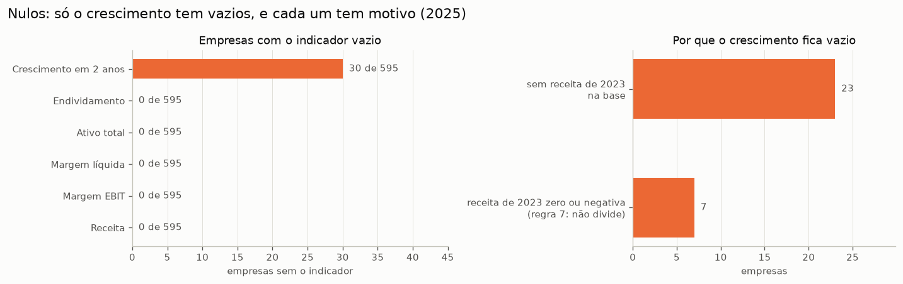
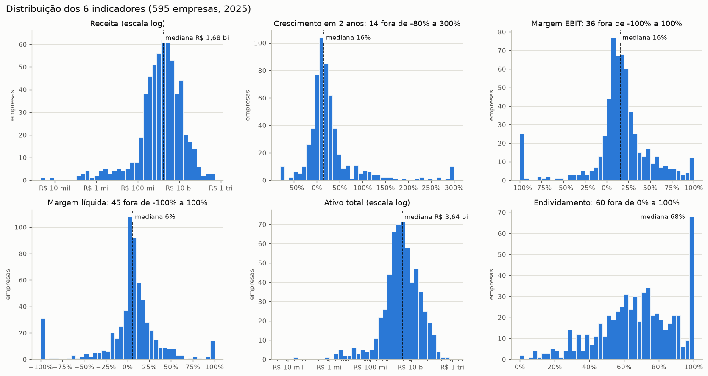
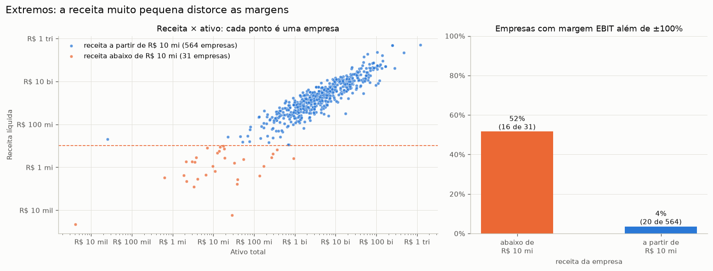
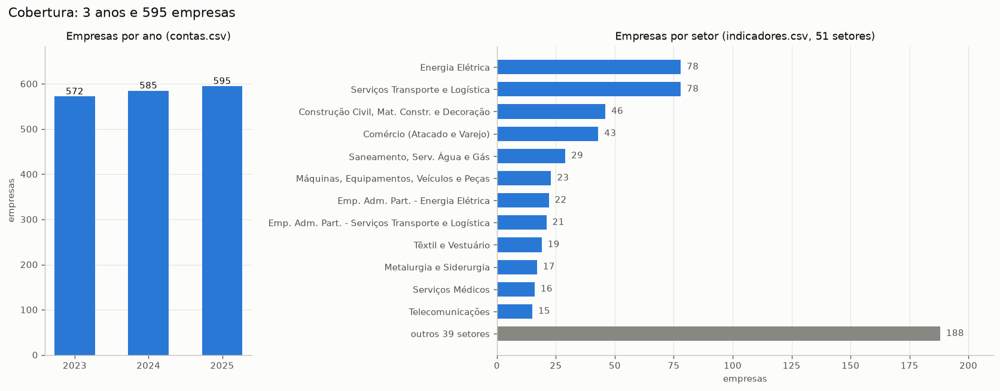
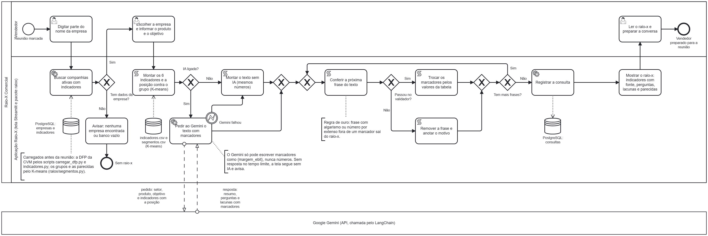
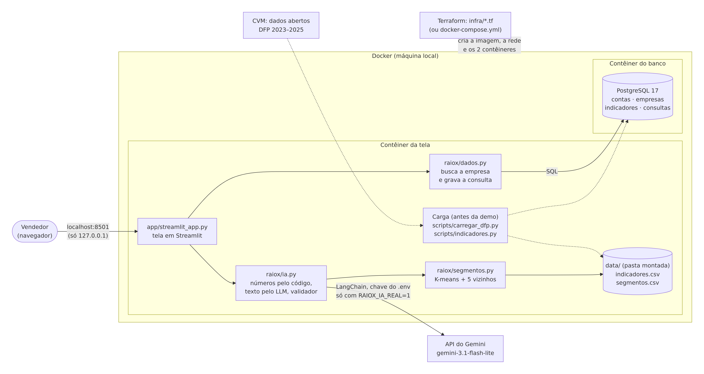
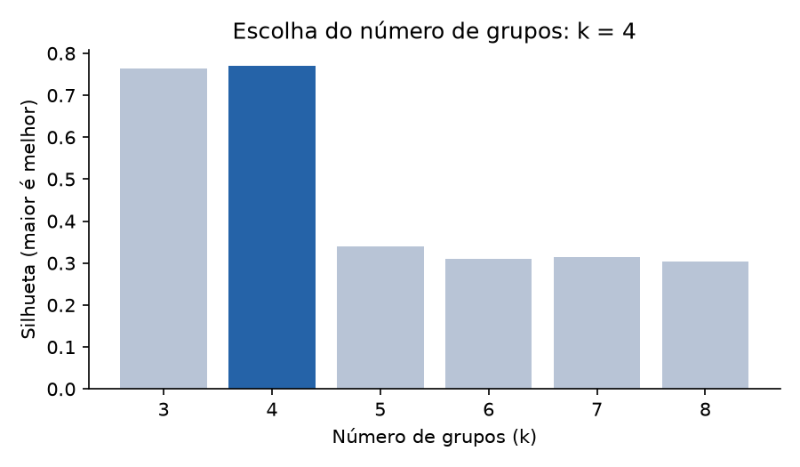
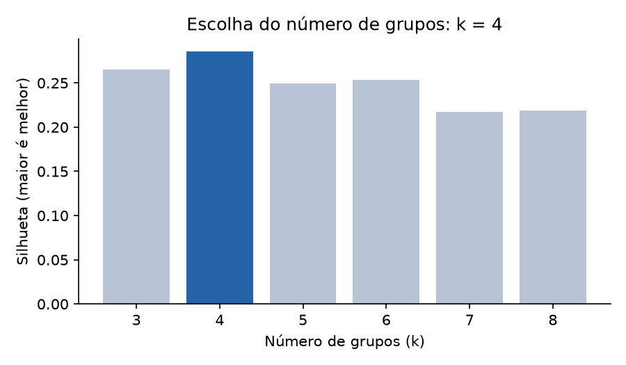
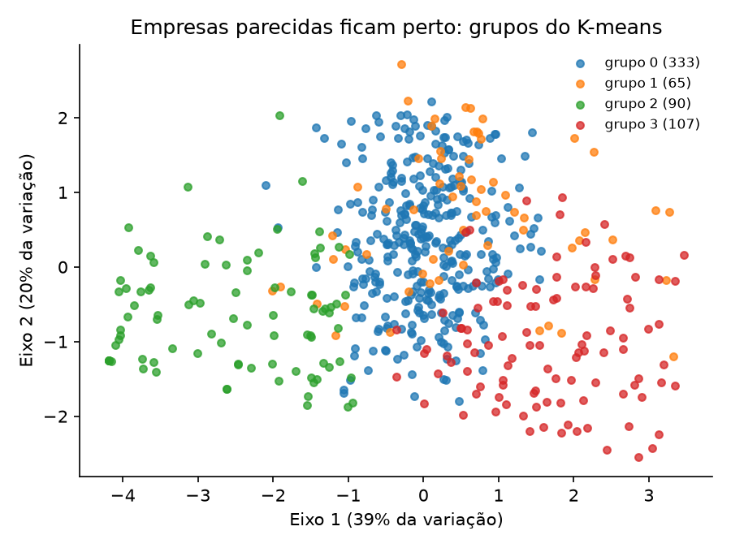

# Raio-X Comercial · Documentação do projeto

**Projeto final da trilha IA Aplicada (SENAI/TCS)** · Equipe: Marcos (dados), Eduardo (IA e gestão), Náthally (produto e métricas),
Miguel (tela e infraestrutura) · Repositório: `MiguelGrispan/trabalho-tcs` (GitHub)

**Versão:** rascunho 4 (para revisão do grupo), 07/11/2026 · Final prevista: seg 09/11/2026 · Entrega: ter 17/11/2026,
48 h antes da banca, em qui 19/11/2026 (dita pelo professor) [PENDENTE: horário da banca a confirmar com o professor]

> **Versão para revisão.** O BPMN, a arquitetura e a EDA já estão no documento. Ainda faltam, marcados com **[PENDENTE]**:
> o ROI (nenhuma medição manual comparável foi entregue até 07/11), o texto final de ética da Náthally e respostas do professor.
> A lista completa está no fim (Apêndice B) e sai da versão final.

## O que este documento cobre

| seção | o que o professor pede | fonte |
|---|---|---|
| 1. O problema e o produto | contexto do tema e do objetivo | `requisitos_projeto.MD`, Documentação |
| 2. Etapas desenvolvidas | "um documento ... explicando as etapas desenvolvidas durante o processo" | `requisitos_projeto.MD`, Documentação |
| 3. Dados: limpeza e indicadores | Python e Pandas para limpeza, nulos e estruturação; SQL | `guia_projeto_final.pdf` §2 |
| 4. Processo (BPMN 2.0) | "Fluxograma BPMN 2.0 do processo" | guia §6; `requisitos_projeto.MD`, Documentação |
| 5. Arquitetura e infraestrutura | arquitetura; "Infraestrutura automatizada com Terraform" | guia §2 e §6; `requisitos_projeto.MD`, Aplicação |
| 6. Justificativa técnica | "Justificativa técnica das escolhas de modelos/arquiteturas (ex.: RAG vs Fine-tuning)" | guia §6 e §7 |
| 7. Ética, governança e segurança | "análise de ética e segurança"; viabilidade, limitações, viés, confiabilidade e uso responsável | guia §2, §5 e §6 |
| 8. Métricas | métricas de sucesso | guia §3 (bloco 5) |
| 9. Como usamos IA para programar | agentic coding; arquivos de prompts do vibecoding | guia §2; `requisitos_projeto.MD`, Aplicação |
| 10. Lições aprendidas | "lições aprendidas do trabalho em equipe" | guia §3 (bloco 6) |

Os dois arquivos do professor estão no repositório, sem mudança, em `docs/professor/`.

---

## 1. O problema e o produto

**Quem usa:** o executivo de contas B2B, que vende produtos ou serviços para empresas grandes.

**A dor:** antes da primeira reunião com uma companhia, ele precisa entender o tamanho dela, se cresce, se a margem está apertada
e se está endividada. Hoje ele abre o site de relações com investidores (RI), procura os números à mão, tenta comparar com o setor
e pensa em perguntas. Leva tempo, cada vendedor faz de um jeito e a comparação com empresas parecidas quase nunca acontece.

**O que o Raio-X entrega.** O vendedor escolhe uma companhia aberta da CVM, diz o que vende e o objetivo da reunião, e recebe em segundos:

- 6 indicadores das demonstrações financeiras entregues à CVM (DFP), cada um com a conta de onde veio;
- a posição de cada indicador contra o grupo de empresas de perfil parecido (K-means);
- 3 a 5 perguntas para a reunião, ligadas ao produto, e o que os números não mostram (lacunas);
- 5 empresas parecidas para prospectar (vizinhos mais próximos).

**A regra de ouro.** O texto é escrito por um LLM (Gemini, via LangChain), mas **o LLM nunca escreve números**. Ele usa
marcadores como `{margem_ebit}`; um validador remove qualquer trecho com número fora de marcador; o código troca os marcadores
pelos valores calculados da tabela. Número inventado num material de vendas é o pior erro possível: os valores mostrados vêm sempre da
tabela, e o validador barra algarismos e as quantidades por extenso que ele conhece (o que ele não pega está na seção 7.2).

**O que já foi medido e o que não foi.** A ferramenta gera um raio-x em **2,15 s em média** (10 casos, seção 8), contando a
montagem dos indicadores, a chamada ao Gemini e a validação; o custo estimado da API é **US$ 0,001185 por raio-x**. Não há, até
06/11, uma medição comparável do tempo de montar o mesmo raio-x à mão (pelo site de RI). Sem ela, este documento **não afirma
ganho de tempo nem ROI**: os 2,15 s não incluem o tempo do vendedor para escolher a empresa, ler e conferir o texto.

[PENDENTE: ROI · NA3, Náthally] *Cronometrar 1 raio-x montado à mão (mesma empresa, mesmos 6 indicadores, pelo site de RI) e
1 com a ferramenta, os dois contando o tempo de ler e conferir; escrever a conta do ganho em 3 linhas.*

---

## 2. Etapas desenvolvidas

O projeto foi planejado para 4 semanas (19/10 a 16/11/2026). O detalhe de cada passo está nos pull requests do repositório
(`gh pr list --state all`) e o resumo diário em `docs/HISTORICO.md`.

### Semana 1 (19 a 25/10): cada um no seu canto
- **Repositório criado** (19/10) e primeiras entregas separadas: produto e regras do texto (Náthally), carga e limpeza da DFP
  (Marcos, numa branch própria) e a primeira versão do Raio-X com IA, segmentação, checador de dados, tela e testes (Eduardo, PR #1).
- A **regra de ouro** nasce no PR #1 (21/10), junto com o `REGRAS-IA.md`, as regras do time para o uso de IA.

### Semana 2 (26/10 a 01/11): juntar tudo e fazer funcionar
- **Fundação** (PR #2, 26/10): uma pasta por dono e o código do Marcos trazido para a estrutura comum.
- **Integração contínua** (27/10): testes automáticos em todo PR, versões fixas (Python 3.14) e os primeiros 3 raio-x com dados
  reais (595 empresas). O teste revelou um problema: o K-means pôs 567 das 595 empresas num grupo só.
- **Segmentação consertada** (PR #9, 28/10): receita mínima de R$ 10 mi, extremos cortados e menor grupo com 5% ou mais.
  A silhueta caiu de 0,77 para 0,30 (0,286 com os dados de 05/11), mas os grupos passaram a ser úteis (seção 6).
- **Prompt da Náthally no código** (PR #11, 29/10): o Gemini lê o arquivo de regras dela, sem cópia. **Avaliação com 10 casos
  reais** (PR #20): 0 trechos removidos pelo validador (seção 8).
- **PostgreSQL** (PRs #21 e #22, 29 e 30/10): o professor fixou o PostgreSQL em aula (SQLite não vale); o CI passou a subir um
  banco só para os testes, para nenhum teste de banco ser pulado.
- **Docker** (PR #24, 30/10): `docker compose up` sobe a tela e o PostgreSQL juntos.
- **Terraform** (PR #29, 31/10): `terraform apply` sobe a mesma infraestrutura; o `destroy` mantém o banco e os dados.
- **Travas para a IA de programação** (PR #30, 31/10): regras que custam caro quebrar viraram bloqueios automáticos (seção 9).

### Semana 3 (02 a 08/11): fechar o código e escrever
- **Justificativa técnica** (PR #31, 02/11) e **tela ligada ao banco** (PR #36, 02/11): a tela busca as empresas no PostgreSQL,
  grava cada consulta e, se o Gemini falhar, cai sozinha no modo sem IA.
- **Demo ponta a ponta** (03/11): Vale, Embraer e Ambev sem IA e WEG com o Gemini (US$ 0,0011), pelo `docker compose` e pelo
  Terraform, com tudo gravado no banco. Tag `v0.1-demo`.
- **Correção do ano fiscal** (PR #46, 03/11): a Camil fecha o exercício em fevereiro, e o sistema mostrava o exercício anterior.
  O "ano" de cada número passou a ser o do exercício. 5 empresas conferidas contra o RI, com diferença de 0,00% (seção 8).
- **Tela mais clara e mais segura** (PR #47, 04/11): aviso curto quando a IA falha, a tela só diz "escrito por IA" quando o Gemini
  respondeu e só abre no próprio computador. A carga da CVM refeita com a correção do ano fiscal deu 595 empresas e a Camil com o
  valor do RI.
- **Decisões de 04/11:** a demo da banca roda no Mac do Eduardo, o único conferido com o compose, o Terraform e o Gemini, e os
  vídeos são gravados nele; este documento passa a ser escrito em markdown e convertido em PDF.
- **BPMN 2.0** (Marcos, PR #52, 04/11; ajustado no #65, 06/11) e **EDA** (Marcos, PR #54, 04/11): a EDA achou um erro de escala
  que a limpeza não pegava (NTS com crescimento de +107.154%), consertado no PR #59 (05/11).
- **Diagrama de arquitetura** (Miguel, PR #55, 05/11) e **legenda da tela** dizendo de onde vem cada número (Miguel, PR #61, 05/11).
- **Avaliação refeita** (Eduardo, PR #58, 05/11): os 10 casos com os dados corrigidos e o K-means treinado de novo (seção 6.2).
- **Consertos antes do congelamento** (Eduardo, PR #63, 05/11): o validador passou a barrar quantidade sem algarismo ("dobrou",
  "um quarto"), a tela acha empresas carregadas depois de aberta e as travas funcionam no Windows. **Limpeza** do código que
  ninguém usava (Marcos, PR #64, 05/11).
- **Código congelado, 07/11:** PR #67 mesclado, com CI verde; tag anotada `v1.0` publicada no commit `2c3e9428902665872811e9d6383a2e8976827825`. Instruções Python corrigidas; 259 testes locais aprovados, nenhum pulado; instalação num venv vazio e ensaio funcional do Streamlit com dados reais e falha simulada de IA conferidos. Sem inspeção visual da demo nem nova chamada paga. [PENDENTE: vídeo final do Miguel ainda não apresentado]
- **Conserto depois do congelamento, 09/11 (`v1.0.1`):** a revisão final (issue #69) achou duas brechas na regra de ouro, ambas
  consertadas com teste: o validador deixava passar "bilionária", "milionária" e "uma vez e meia"; e, se o Gemini devolvesse o
  formato errado, a mensagem de erro em "Detalhes técnicos" copiava o texto dele, com números. Nenhum dos 10 textos reais do
  Gemini (`resultados.csv`) seria barrado pelas palavras novas. 263 testes aprovados, nenhum pulado.

- **EDA reconferida, 07/11:** as 15 células de código de `notebooks/eda.ipynb` executaram com dados reais, gerando quatro gráficos e o resumo de 595 empresas e 384.591 linhas de contas. Notebook e PNG originais foram preservados; as saídas de auditoria ficaram fora do Git. As figuras já estão na seção 3.

### Semana 4 (09 a 17/11): entregar e ensaiar
- Documento, deck e vídeo da demo previstos para qua 11/11; ensaios cronometrados; entrega em ter 17/11; banca em qui 19/11
  (a confirmar).

### As decisões que mais mudaram o projeto

| data | decisão | por quê |
|---|---|---|
| 21/10 | o LLM nunca escreve números; usa marcadores | número inventado num material de vendas é o pior erro possível |
| 26/10 | cada pasta tem um dono | quatro pessoas no mesmo arquivo geravam conflito |
| 28/10 | K-means só com receita a partir de R$ 10 mi, extremos cortados, menor grupo com 5% ou mais | sem isso, um grupo tinha 567 das 595 empresas |
| 28/10 | "empresas parecidas" = mesmo perfil financeiro, não o mesmo setor | é o que o modelo mede |
| 29/10 | banco PostgreSQL | regra do professor: SQLite não vale |
| 30/10 | Terraform obrigatório | `requisitos_projeto.MD`, Aplicação: "Infraestrutura automatizada com Terraform" |
| 30/10 | o Gemini desiste em até uns 30 s (15 s por tentativa, 2 tentativas) | sem limite, a API travada deixava a tela girando, sem chegar ao plano B |
| 31/10 | a chave do Gemini não passa pelo Terraform | variável do Terraform fica em texto puro no `terraform.tfstate` |
| 02/11 | sem RAG vetorial, sem fine-tuning, sem memória e sem agente | seção 6 |
| 02/11 | a aplicação é o Streamlit, em 2 contêineres (tela + banco) | resposta do professor: "um contêiner para ele e a aplicação e um para o SQL" |
| 03/11 | o "ano" de cada número é o do exercício, e não o do arquivo da CVM | a Camil aparecia com o exercício anterior |
| 05/11 | não treinar o K-means de novo antes da banca; os 10 casos no mesmo grupo viram limite declarado (issue #60) | mudar o modelo a 1 dia do congelamento arriscaria a demo; o limite está explicado na seção 6.2 |

---

## 3. Dados: limpeza e indicadores

### A fonte
Dados abertos da CVM, em CSV: o cadastro das companhias abertas (`cad_cia_aberta.csv`: código, nome, situação e setor) e os
arquivos anuais da DFP (`dfp_cia_aberta_AAAA.zip`). Da DFP usamos a DRE (resultado), o BPA (ativo) e o BPP (passivo e patrimônio),
consolidados e individuais. São baixados os exercícios de 2023 a 2025, mais o arquivo de 2026, onde está o exercício 2025 de quem
fecha o ano fora de dezembro (`scripts/carregar_dfp.py`).

### Regras de limpeza, na ordem
As regras 1 a 7 estão no código com o mesmo número, em `scripts/carregar_dfp.py` (regra 1) e `raiox/limpeza.py` (as outras).

1. **Ler** com `sep=";"`, `encoding="latin-1"`, `decimal=","` e `CD_CONTA` como texto. Lido como número, o código de conta
   `3.10` viraria `3.1`. (`ler_demo()`, `scripts/carregar_dfp.py`)
2. **Só o exercício do ano** (`ORDEM_EXERC == "ÚLTIMO"`): a CVM manda também o ano anterior, e cada conta apareceria duas vezes.
3. **Só a maior versão** de cada empresa: reapresentações substituem a entrega original. Se a mesma versão traz dois períodos,
   fica o fim de exercício mais recente. (`limpar_demo()`)
4. **Escala:** `ESCALA_MOEDA = MIL` vira × 1.000. Além disso, o código acha empresas que declaram "unidade" mas mandam milhares:
   a receita cai cerca de 1.000 vezes de um ano para o outro e, multiplicada por 1.000, fica parecida com a do ano anterior.
   Esses anos são corrigidos e o script avisa. (`encontrar_escala_errada()` e `corrigir_escala()`)
5. **Consolidado primeiro:** sem demonstração consolidada, usa a individual e anota a origem (`con` ou `ind`).
   (`preferir_consolidado()`)
6. **Só empresas com receita de venda positiva** no último ano: bancos e seguradoras usam a conta 3.01 para outras receitas
   (ex.: "Receitas da Intermediação Financeira") e ficam de fora. (`filtrar_empresas_com_receita()`)
7. **Nulos: não inventar.** Valor que falta fica vazio, e a tela mostra "sem dado". Se a mesma conta aparece duas vezes com
   valores diferentes, o valor fica vazio em vez de escolher um (`resolver_conflitos()`). Divisão por zero ou por valor
   negativo deixa o indicador vazio em vez de infinito (`montar_indicadores()`, `scripts/indicadores.py`).

**O ano do exercício** (PR #46). A CVM arquiva cada DFP pelo ano em que o exercício termina, mas nem toda empresa fecha em dezembro.
A Camil fecha em fevereiro: o "2025" dela vai de mar/2025 a fev/2026. O ano de cada número passou a ser aquele em que cai a maior
parte dos meses do exercício (`ano_do_exercicio()`, `raiox/limpeza.py`). Mudaram as 9 empresas que fecham fora de dezembro; a receita
da Camil foi de R$ 12,26 bi (o exercício anterior) para R$ 11,12 bi, o valor do RI.

### Os 6 indicadores
Uma linha por empresa, no último exercício (`montar_indicadores()`, `scripts/indicadores.py`; formato no contrato C2, `contratos.md`).

| indicador | fórmula | contas da DFP | o que diz ao vendedor |
|---|---|---|---|
| Receita líquida | valor da conta, último ano | DRE 3.01 | tamanho da empresa |
| Crescimento em dois anos | receita do último ano ÷ receita de 2 anos antes − 1 | DRE 3.01 | está expandindo ou encolhendo |
| Margem EBIT | resultado antes do resultado financeiro e dos tributos ÷ receita | DRE 3.05 ÷ 3.01 | pressão de custo na operação |
| Margem líquida | lucro do período ÷ receita | DRE 3.11 ÷ 3.01 | o que sobra depois de juros e impostos |
| Ativo total | valor da conta, último ano | BPA 1 | tamanho pelo que a empresa tem |
| Endividamento | 1 − patrimônio líquido ÷ ativo total | BPP 2.03 e BPA 1 | quanto depende de terceiros |

### Onde os dados ficam (SQL)
O PostgreSQL 17 guarda as tabelas `contas` (uma linha por empresa × ano × demonstração × conta, com índice único que recusa
conta repetida), `empresas` (do cadastro), `indicadores` (os 6 indicadores) e `consultas` (cada raio-x pedido na tela: empresa,
produto, objetivo, tempo e custo). A busca da tela usa `ILIKE` e devolve só companhias ativas e com indicadores (`raiox/dados.py`).
Se o banco estiver desligado, a conexão desiste em 5 s e a tela mostra o que fazer, em vez de travar (`raiox/banco.py`).

**Resultado da carga** (Marcos, 03/11): 384.591 linhas de contas e 595 empresas com os 6 indicadores, em 1 min 48 s. A base
usada neste documento (carga de 05/11, depois do PR #59) tem os mesmos totais: 384.591 linhas e 595 empresas.

### Auditoria dos dados
`raiox/checagem.py` aplica regras de sanidade (ex.: margem acima de 100%, receita que muda demais) e **só aponta**: quem decide
é uma pessoa. Com os dados de 05/11: nenhum "erro" e 179 "atenção" em 98 empresas.

### Análise exploratória (EDA)
O notebook `notebooks/eda.ipynb` (Marcos, PR #54) olha os dados antes de usá-los. Cada gráfico gerou uma decisão do projeto.

*Figura 1. Nulos. Todas as empresas têm as 5 contas do último ano; o único indicador com vazios é o crescimento (falta a DFP de
2 anos antes ou a receita daquele ano era zero ou negativa). Decisão: o vazio continua vazio até a tela ("sem dado"); só o K-means usa a mediana.*

*Figura 2. Distribuições. Receita e ativo só têm forma de sino na escala log, e poucas gigantes puxam a média. Decisão: comparar
pela mediana do grupo, e o K-means usa o log da receita.*

*Figura 3. Extremos. Abaixo do corte de R$ 10 mi de receita estão holdings e securitizadoras, com margens sem sentido. Decisão:
o K-means aprende só a partir do corte; os extremos não são apagados, são marcados para conferir na fonte.*

*Figura 4. Cobertura. Os 3 anos têm quase o mesmo número de empresas, mas os setores são desiguais. Decisão: grupos por perfil
financeiro, e não por setor; o lado ruim está na seção 7.3.*

---

## 4. Processo de negócio (BPMN 2.0)

O diagrama (Marcos, PRs #52 e #65; arquivo editável `docs/bpmn/raio-x-comercial.bpmn`, feito no bpmn.io) mostra o processo
de negócio com o Raio-X. A piscina **Raio-X Comercial** tem as raias **Vendedor** e **Aplicação Raio-X** (tela Streamlit e pacote
`raiox`); o **Google Gemini** é uma piscina separada, porque é um serviço de fora, chamado pelo LangChain.

<!-- pagina-deitada -->

*Figura 5. BPMN 2.0 do processo, da reunião marcada ao vendedor preparado. Os dados da CVM, os grupos do K-means e as parecidas
são carregados antes da reunião (anotação à esquerda).*

<!-- /pagina-deitada -->

O caminho, na ordem do diagrama:

1. o vendedor digita parte do nome; a aplicação busca companhias ativas com indicadores no PostgreSQL;
2. decisão **"A busca achou empresa?"**: se o nome não foi encontrado, o vendedor vê o aviso e tenta outro nome; se o banco está
   vazio ou desligado, a aplicação avisa e o processo acaba sem raio-x;
3. o vendedor escolhe a empresa e informa o produto e o objetivo; a aplicação monta os 6 indicadores e a posição contra o grupo,
   já calculados (`indicadores.csv` e `segmentos.csv`); se a empresa não estiver nessa tabela (evento de erro), avisa que o raio-x
   não pôde ser gerado e o processo acaba. Em seguida, anexa a cada indicador as contas do DFP usadas e o link do documento na CVM
   (tabelas `contas` e `links_dfp`, nunca o Gemini); se faltar dado, o raio-x sai igual, sem essa parte;
4. decisão **"IA ligada?"**: se sim, pede ao Gemini o texto com marcadores; se não, ou se o Gemini falhar (evento de erro: tempo,
   erro da API ou formato errado), monta o texto sem IA, com os mesmos números;
5. para cada item (resumo, cada pergunta, cada lacuna), decisão **"Passou no validador?"**: se sim, troca os marcadores pelos
   valores da tabela; se não, remove o item e anota o motivo;
6. registra a consulta no PostgreSQL (se falhar, só avisa) e mostra o raio-x com fonte, perguntas, lacunas e parecidas;
7. o vendedor lê o raio-x e prepara a conversa: a revisão humana fica no fim do processo.

---

## 5. Arquitetura e infraestrutura

### Os componentes
O diagrama completo é a Figura 6, logo abaixo.

- **Preparação** (roda uma vez; refaz quando sai DFP nova): `scripts/carregar_dfp.py` baixa e limpa a DFP da CVM e grava as tabelas
  `contas` e `empresas`; `scripts/indicadores.py` calcula os 6 indicadores (tabela `indicadores` e `data/indicadores.csv`);
  `raiox/segmentos.py` treina o K-means e acha as parecidas (`data/segmentos.csv`).
- **Consulta** (a cada uso, alguns segundos): a tela (`app/streamlit_app.py`) busca a empresa no PostgreSQL (`raiox/dados.py`),
  pede o raio-x a `raiox/ia.py` (números e posição pelo código, texto pelo Gemini só com marcadores, validador) e grava a consulta
  na tabela `consultas`. Sem IA ou com a API fora do ar, o texto é montado por modelo fixo.
- **De onde vem cada coisa:** a busca e o registro das consultas usam o PostgreSQL; os números do raio-x vêm da
  `data/indicadores.csv`, gerada pelo mesmo script que grava a tabela `indicadores` (a tela diz isso desde o PR #61).

Os formatos entre as partes (C1 a C4) estão no `contratos.md`: cada um trabalhou contra dados falsos no formato combinado
(`falsos/`) até o colega entregar.

<!-- pagina-deitada -->

*Figura 6. Arquitetura (Miguel, PR #55; o mesmo diagrama está em texto Mermaid na seção "Arquitetura" do `README.md`). O
Terraform cria a imagem, a rede e os 2 contêineres no Docker local; o vendedor abre a tela só em `127.0.0.1:8501`.*

<!-- /pagina-deitada -->

### Dois contêineres, dois caminhos para subir
A aplicação roda em **2 contêineres**, como o professor orientou: um com a tela e a aplicação (Streamlit + `raiox/`) e outro com
o PostgreSQL. O Streamlit faz o papel de frontend (a tela) e o código de `raiox/` o de backend.

| | `docker compose` | Terraform (obrigatório) |
|---|---|---|
| arquivo | `docker-compose.yml` | `infra/*.tf`, com o provider Docker (`kreuzwerker/docker`) |
| sobe | `docker compose up -d --build` | `terraform apply` |
| derruba | `docker compose down` | `terraform destroy` (o banco e a `data/` continuam) |
| conferido | Linux (Miguel, 30/10) e Mac (Eduardo, 03/11) | Linux (Miguel, 31/10) e Mac (Eduardo, 03/11): 2º `plan` sem mudanças |

O Terraform roda localmente, no Docker do computador (`requisitos_projeto.MD`, Aplicação: "podendo rodar localmente ou na nuvem").
O volume do banco fica fora do Terraform, para o `destroy` não apagar os dados carregados. O CI confere o Terraform
(`terraform fmt` e `terraform validate`) em todo PR que mexe em `infra/`.

### Tecnologias

| parte | tecnologia |
|---|---|
| linguagem | Python 3.14, versões fixas no `requirements.txt` |
| dados | Pandas 3.0, NumPy 2.5; dados abertos da CVM |
| gráficos e EDA | Matplotlib 3.11, Jupyter |
| banco | PostgreSQL 17, SQLAlchemy 2.1, psycopg 3.3 |
| machine learning | scikit-learn 1.9 (KMeans, NearestNeighbors, StandardScaler) |
| IA generativa | Gemini `gemini-3.1-flash-lite` por API, LangChain, saída estruturada com Pydantic |
| tela | Streamlit 1.66 |
| infraestrutura | Docker, Docker Compose, Terraform 1.17 |
| testes e CI | pytest 9.1, GitHub Actions com um PostgreSQL só para os testes |

---

## 6. Justificativa técnica

### 6.1 O problema decide a arquitetura
O vendedor precisa de **números certos** e de **texto útil**. Cada parte do sistema faz o que faz melhor:

| quem | faz | por quê |
|---|---|---|
| código (Pandas) | calcula todos os números a partir da DFP | cálculo é determinístico e auditável: cada número tem conta e ano |
| ML (scikit-learn) | acha o grupo de empresas parecidas e as 5 mais próximas | não há rótulo de "empresa parecida": é aprendizado não supervisionado |
| LLM (Gemini) | escreve o texto com marcadores, nunca o número | escrever é o que o LLM faz bem; copiar e arredondar número é onde ele erra |
| validador (código) | remove o trecho com número fora de marcador e troca os marcadores pelos valores | é a regra de ouro |

### 6.2 Machine learning: K-means + vizinhos mais próximos
O ML faz **duas coisas diferentes**, com dois algoritmos:

| saída na tela | de onde vem | para que serve |
|---|---|---|
| **referência de grupo** (a mediana do grupo em cada indicador e a posição "acima", "abaixo" ou "em linha") | **K-means**: a empresa cai num dos 4 grupos, e o código calcula a mediana de cada indicador entre as empresas do grupo (`montar()`, `raiox/ia.py`) | dizer se a margem, o crescimento ou o endividamento estão bons **para empresas de perfil parecido** |
| **5 empresas parecidas** para prospectar | **vizinhos mais próximos** (`NearestNeighbors`), no mesmo espaço das 5 variáveis, sem olhar o grupo | achar as empresas individualmente mais próximas, mesmo que o grupo seja grande |

- **Não supervisionado** porque não existe uma coluna "grupo certo" para treinar: o K-means descobre os grupos sozinho.
- **5 variáveis:** log da receita, crescimento em dois anos, margem EBIT, margem líquida e endividamento. O log porque a receita
  vai de milhões a centenas de bilhões; sem ele, só o tamanho decidiria o grupo.
- **Preparo:** extremos cortados nos percentis 5 e 95, nulos preenchidos com a mediana (só para o modelo; a tela mostra o valor
  real ou "sem dado") e `StandardScaler`, para todas as variáveis ficarem na mesma régua.
- **Treino só com receita a partir de R$ 10 mi:** abaixo disso estão 31 empresas, 52% delas com margem EBIT acima de 100% ou
  abaixo de −100% (holdings e empresas sem operação); acima, 564 empresas e 4% (`scripts/avaliar_corte_receita.py`, 03/11).
  As empresas menores recebem o grupo mais próximo, sem participar do treino.
- **Escolha do k:** testa k de 3 a 8 e fica com a maior silhueta, **mas só entre os k em que o menor grupo tem pelo menos 5% das
  empresas** (`escolher_k()`, `raiox/segmentos.py`).
- **5 parecidas:** `NearestNeighbors` com 6 vizinhos no mesmo espaço padronizado, porque o 1º vizinho é a própria empresa.

**Resultado na base da entrega** (carga de 05/11, depois das correções dos PRs #46 e #59; conferido de novo em 06/11):
**k = 4, silhueta 0,286**, grupos de 60, 310, 88 e 106 empresas no treino (564 empresas). Com as 595, contando as que só recebem
o grupo mais próximo: 66, 312, 103 e 114. Silhueta dos outros k: 0,265 (k = 3), 0,250 (5), 0,253 (6), 0,217 (7) e 0,219 (8).

**Por que a silhueta de 0,77 enganava.** Antes da regra dos 5%, a silhueta era 0,77 e parecia ótima, mas o modelo só separava
28 empresas extremas, em 3 grupos pequenos, e juntava todas as outras num grupo só: 567 das 595. Com a regra, a silhueta cai para 0,30 (0,286 com os
dados de 05/11) e os grupos passam a servir para comparar. Preferimos grupos úteis a um número bonito.

**O limite: os 10 casos de avaliação caem no mesmo grupo** (issue #60). As 10 empresas da avaliação (seção 8) estão todas no
grupo de 312 empresas, que vai de R$ 284 mil a R$ 497,5 bi de receita, com mediana de R$ 3,6 bi. As 10 têm receita de
R$ 11,1 bi (Camil) a R$ 497,5 bi (Petrobras) e ficam entre os 27% maiores do grupo em receita. Por isso, nos 10 raio-x, **receita
e ativo saem "acima do grupo" em todos os casos**: a referência de grupo não distingue porte entre empresas grandes, e a
Petrobras é comparada com a mesma mediana da Camil. O motivo é o desenho do modelo: o tamanho (log da receita) é só 1 das 5 variáveis, e
os grupos se separam mais pelo perfil. Os outros 3 grupos são os que fogem do comum (crescimento alto, prejuízo com dívida alta,
margem muito alta); este é o grupo do "perfil comum" (medianas: crescimento de 15%, margem EBIT de 13%, endividamento de 66%),
onde cabem de empresas pequenas a gigantes.
O que atenua: as **5 parecidas** vêm dos vizinhos, não do grupo, e para esses casos são empresas grandes (ex.: as da Petrobras
são CPFL, TIM, Motiva, Neoenergia e Suzano). A comparação de **margens e endividamento** contra o grupo continua útil; a de
**tamanho**, não. Decidimos não treinar de novo antes da banca (seção 2) e declarar o limite (seção 7.3).

*Figura 7. Silhueta por k antes da regra dos 5% (27/10): 0,77 em k = 4, com quase todas as empresas num grupo só.*

*Figura 8. Silhueta por k depois da regra dos 5% (dados de 05/11): 0,286 em k = 4.*

*Figura 9. Os 4 grupos projetados em 2 dimensões (PCA), com os dados de 05/11 (a legenda conta as 595 empresas). As 5
variáveis viram 2 eixos só para desenhar; o modelo usa as 5.*

### 6.3 IA generativa: por que nem RAG vetorial nem fine-tuning
**A base de dados da IA** é a tabela de indicadores calculada da DFP da CVM. O código busca a linha exata da empresa pelo
código CVM (`montar()`, `raiox/ia.py`) e entrega ao Gemini, para cada indicador, o nome, o valor da empresa, a mediana do grupo
(já formatados, ex.: "R$ 12,3 bi") e a posição ("acima", "abaixo" ou "em linha"), calculada por código. O Gemini **lê** esses
valores para entender a empresa, mas **só pode escrever os marcadores**. É geração aumentada por recuperação, com a recuperação
**estruturada** (pela chave da empresa), e não semântica (por embeddings).

| opção | o que seria | por que não usamos |
|---|---|---|
| RAG vetorial | quebrar documentos em pedaços, gerar embeddings e buscar os trechos mais parecidos com a pergunta | os dados são números em tabela, não texto. Busca por semelhança pode trazer a empresa ou o ano errado; busca por chave traz sempre a linha certa. Exigiria também um banco vetorial a mais |
| Fine-tuning | treinar o modelo com exemplos de raio-x bons | não temos centenas de exemplos rotulados; custa mais; os dados mudam todo ano; e treinar **não impede** o modelo de errar número, que é o risco principal |
| **O que usamos** | prompt + saída estruturada (Pydantic) + validador | barato (US$ 0,001185 por raio-x, estimado pelos tokens), reproduzível e conferível |

Se a tabela de indicadores conta como a "base de dados de conhecimento" que o `requisitos_projeto.MD` pede (Integração com IA de terceiro) é uma
pergunta ao professor, ainda sem resposta. O projeto também segue o caminho "Treinamento de Machine Learning" (seção 6.2), e o
`requisitos_projeto.MD` pede uma das duas abordagens. [PENDENTE: resposta do professor à pergunta 3]

**Quando o RAG passaria a valer:** se o raio-x tivesse de ler texto livre, como o release de resultados ou as notas explicativas da DFP.

### 6.4 Chain, memória e agentes no LangChain
- **Uma chain de dois passos** (`_chain()`, `raiox/ia.py`): `ChatPromptTemplate` (as regras como mensagem de sistema + o pedido)
  → `ChatGoogleGenerativeAI(...).with_structured_output(RaioX)`.
- **Saída estruturada:** a resposta volta no formato `RaioX` (resumo, perguntas e lacunas), garantido pelo Pydantic.
- **O prompt de sistema** é o arquivo de regras da Náthally (`avaliacao/regras_prompt.md`), lido sem cópia, mais 3 notas do código.
  Assim, o que a dona das regras escreve chega inteiro ao modelo.
- **Modelo pequeno** (`gemini-3.1-flash-lite`, `temperature=0.2`): a tarefa é escrever 3 frases e algumas perguntas; um modelo
  pequeno basta, custa menos e varia pouco entre uma chamada e outra.
- **Limites:** 15 s por tentativa e 2 tentativas. Se a API travar, o erro chega em uns 30 s e a tela não fica girando.
- **Sem memória, de propósito:** cada raio-x é independente. Memória de conversa só traria o risco de misturar dados de uma
  empresa na outra.
- **Sem agente, de propósito:** o caminho é sempre o mesmo (buscar → calcular → escrever → validar). Não há decisão para um
  agente tomar, e um pipeline fixo é mais previsível e mais fácil de testar.
- **Plano B sem IA:** `texto_sem_ia()` monta o texto por modelo fixo, com os mesmos marcadores e o mesmo validador. A demo
  funciona sem a chave do Gemini.

---

## 7. Ética, governança e segurança

[PENDENTE: texto final · NA5, Náthally, sáb 07 a dom 08/11] *Esta seção é a base técnica (`docs/etica.md`), atualizada em 06/11.
A Náthally reescreve para a banca e completa a viabilidade.*

### 7.1 O risco principal: número inventado
O LLM pode inventar ou arredondar um número, e o vendedor levaria um dado falso para a reunião. Por isso o LLM só escreve
marcadores e o validador (`checar()` e `validar_e_preencher()`, `raiox/ia.py`) barra:
- algarismos de qualquer escrita (inclusive ½ e ²);
- números e quantidades por extenso: "dez", "o dobro", "metade" e, desde o PR #63 (05/11, issue #50), também "dobrou",
  "triplicou", "um quarto" e "meio ponto" ("quarto trimestre" e "duplicatas" continuam liberados);
- marcadores que não estão na lista da empresa.

Se o resumo tiver um desses, ele sai inteiro; perguntas e lacunas saem uma a uma; tudo o que sai fica registrado.
**Resultado:** nos 10 raio-x da avaliação, **0 trechos removidos** (seção 8). Isso quer dizer que o Gemini seguiu a regra e não
escreveu número; **não** quer dizer que o texto está certo (7.2).

### 7.2 O que o validador não pega
O validador olha a **forma** do texto (tem número? o marcador existe?), não o **sentido**. Conferido em 06/11 com `checar()`:
"A receita dobrou" é barrada, mas as duas frases abaixo passam.
- **Marcador certo no indicador errado:** em "A margem EBIT de `{endividamento}` está acima do grupo", o marcador existe e é
  permitido, então a frase passa, e a tela mostraria o endividamento como se fosse a margem. O valor é verdadeiro, mas está no
  lugar errado. O que protege: a regra do prompt (nome do indicador antes do marcador dele) e o cartão de cada indicador na tela,
  com o valor e a fonte.
- **Afirmação falsa sem número:** "A empresa perdeu clientes para a concorrência" não tem número nem marcador e passa, mesmo que
  seja falsa. O mesmo vale para:
  - pergunta com suposição falsa (ex.: supor que os custos explicam uma margem baixa);
  - "acima" ou "abaixo" trocado na frase: a posição é calculada por código, mas a palavra na frase é do LLM;
  - lacuna genérica ("quem decide a compra" serve para qualquer empresa);
  - interpretação de setor: o modelo pode associar a empresa a um negócio que ela não tem.

O que resolve, no fim, é a leitura humana. Por isso o raio-x é apoio, e não decisão (7.6).

### 7.3 Viés e limites do modelo de ML
- **Só companhias abertas:** empresas fechadas, pequenas ou médias não aparecem. A ferramenta serve para grandes contas.
- **Empresas pequenas:** as 31 com receita abaixo de R$ 10 mi recebem um grupo sem terem ajudado a formá-lo; para elas, a
  comparação é menos confiável.
- **Extremos cortados só no modelo:** os números mostrados são os reais, mas uma empresa muito fora da curva fica num grupo que
  não a representa bem.
- **Perfil financeiro, não setor:** com os dados de 05/11, as parecidas da WEG (máquinas) incluem Cemig e Copel (energia),
  Votorantim Cimentos e Telefônica: empresas grandes, rentáveis e pouco endividadas, mas de outros setores. Isso serve para prospectar perfis
  parecidos, mas não são concorrentes.
- **Silhueta 0,286:** os grupos se sobrepõem. É uma régua de comparação, não uma classificação exata.
- **Os 10 casos da avaliação caem no mesmo grupo** (o maior, com 312 empresas e receita mediana de R$ 3,6 bi). Receita e ativo
  saem "acima do grupo" nos 10, e a Petrobras (R$ 497,5 bi de receita) é comparada com a mesma mediana da Camil (R$ 11,1 bi): a
  comparação por porte diz pouco para empresas grandes (seção 6.2, issue #60).

### 7.4 Confiabilidade dos dados
- **Dado anual, que pode ter mais de um ano:** a DFP sai uma vez por ano; resultado trimestral não entra. O ano aparece em cada número.
- **Fonte em cada número:** cada indicador mostra a conta da DFP de onde veio, para o vendedor conferir.
- **Conferência contra o RI** (Marcos, 03/11, `avaliacao/conferencia.csv`): 13 valores de 5 empresas (WEG, Camil, Magalu,
  RD Saúde e CSN), todos com diferença de 0,00%. O ativo e o patrimônio da RD Saúde vêm da coluna comparativa de 31/12/2025 no ITR
  de 30/06/2026; os outros 11, das demonstrações do exercício.
- **A conferência manual** (Náthally) deu 7 de 10 em 29/10 e **8 de 10 em 05/11**: em 8 dos 10 casos, os 6 indicadores
  mostrados batem com os que ela calculou dos documentos da empresa (critério: receita e ativo com até 1% de diferença;
  percentuais com até 0,15 ponto). A Camil era um erro nosso (o ano fiscal), corrigido no PR #46. Esse "8 de 10" mede os
  **números** e não tem relação com os "0 trechos removidos" do validador, que mede o **texto** do Gemini (seção 8.1).
  As 2 diferenças que sobram são de **definição contábil**, conferidas nos PDFs usados por ela:
  - **RD Saúde:** a conferência usou a tabela "Pré-IFRS 16" do Relatório da Administração, que está no PDF da DFP 2025 (p. 48 da
    DFP) e tira os aluguéis das lojas: ativo R$ 20,6 bi, endividamento 62,44%, margem EBIT 5,27% (EBIT ajustado). O sistema usa a
    DFP oficial, com IFRS 16: ativo R$ 25,2 bi (com R$ 4,3 bi de direito de uso das lojas), 70,9% e 6,2%.
  - **Magazine Luiza:** os 5,81% da conferência saem do EBIT oficial (R$ 1.918,7 mi) sem as perdas de créditos esperadas e sem a
    equivalência patrimonial; o sistema usa a linha oficial da DRE (4,96%). Reconstrução nossa; falta a Náthally confirmar.
- **Número oficial × "ajustado":** empresas divulgam no release números "ajustados" ou "Pré-IFRS 16", e o vendedor pode ouvi-los
  na reunião. O raio-x mostra o número contábil oficial, igual para as 595 empresas, que pode ser diferente.

### 7.5 Segurança de dados
- **Chave do Gemini** só no `.env`, fora do Git. No Terraform, o `.env` é montado só para leitura e a chave não passa por variável,
  então não fica no `terraform.tfstate`. Nenhuma chave em todo o histórico do Git (busca pelo padrão de chave, 29/10).
- **Ponto fraco conhecido:** a senha do PostgreSQL local passa por variável do Terraform e fica no `terraform.tfstate`, que não vai
  para o Git. O banco só aceita conexões do próprio computador (`127.0.0.1`).
- **A tela só abre no próprio computador** (`127.0.0.1`), no `docker compose` e no Terraform. Até o PR #47 (04/11, issue #44), o
  compose abria a tela para a rede toda: com a IA ligada, qualquer um no mesmo Wi-Fi abria a tela e gastava crédito.
- **O erro técnico da IA não aparece para o vendedor:** o aviso tem uma frase, e o erro do Google vai para "Detalhes técnicos" e
  para o log (PR #47, issue #38).
- **O que vai para o Gemini:** o setor, os indicadores já formatados com a posição, o tamanho do grupo, o produto e o objetivo.
  Nem o nome da empresa vai (`montar()`, `raiox/ia.py`). A chave do projeto usa o plano pago (pré-pago, com cobrança), e os termos
  da API do Gemini para os serviços pagos ("Gemini API Additional Terms of Service", em vigor desde 23/03/2026, conferidos em
  06/11) dizem que o Google **não usa os prompts nem as respostas para melhorar os produtos dele**; guarda os registros por um
  tempo limitado, só para detectar abuso e por exigência legal, e pode armazená-los em qualquer país. No plano gratuito é o
  contrário: o conteúdo pode ser lido por revisores humanos e usado para melhorar os produtos.
- **O que fica gravado:** a tabela `consultas` guarda empresa, produto, objetivo, tempo e custo. Não há dado pessoal, mas o produto
  e o objetivo são texto livre: o vendedor não deve escrever nome de pessoa ou dado sigiloso ali.
- **Travas na IA de programação:** a IA que ajudou a escrever o código não lê o `.env`, não faz commit de dados nem de chaves e
  pergunta antes do merge (seção 9).

### 7.6 Uso responsável
- **Apoio, não decisão:** o raio-x prepara a primeira reunião; o vendedor confere antes de usar. A tela avisa: "Confira antes de usar".
- **Não é recomendação de investimento:** o mesmo aviso, na tela.
- **Se a IA falhar, a ferramenta continua:** a tela monta o texto sem IA, com os mesmos números, e avisa. Conferido em 03/11 com
  uma chave inválida: WEG gerada sem IA e consulta gravada com custo 0. Desde o PR #47, a tela só diz que o texto foi escrito por IA
  quando o Gemini respondeu (issue #39).
- **Custo acompanhado:** cada consulta grava os tokens e o custo.

### 7.7 Viabilidade
- **Custo estimado da API por raio-x:** US$ 0,001185 em média (seção 8), calculado com os tokens de cada chamada e o preço
  oficial; não inclui o computador onde a aplicação roda.
- **Tempo para gerar um raio-x:** 2,15 s em média (rodada de 05/11), contando a montagem dos indicadores, a chamada ao Gemini e
  a validação.
- **Manutenção:** a DFP é anual; a base é recarregada uma vez por ano com 2 comandos (`scripts/carregar_dfp.py` e
  `scripts/indicadores.py`), e o K-means com `python -m raiox.segmentos`.
- **Ganho para o vendedor (ROI):** não medido. Sem um tempo manual comparável, não afirmamos redução de tempo (seção 1).
  [PENDENTE: ROI · NA3, Náthally]

---

## 8. Métricas

### 8.1 Avaliação com 10 casos reais (`avaliacao/resultados.csv`)
10 raio-x com o Gemini, um por caso de `avaliacao/casos_avaliacao.csv` (empresa, produto e objetivo escritos pela Náthally):
Camil, CSN, Magazine Luiza, Petrobras, Embraer, Suzano, Raia Drogasil, Localiza, WEG e Telefônica. A 1ª rodada foi em 29/10
(PR #20); a de hoje, em 05/11 (PR #58), com os dados depois dos PRs #46 e #59.

São duas medidas diferentes, que não devem ser somadas nem confundidas:

| o que mede | resultado | de onde vem |
|---|---|---|
| **números certos:** os 6 indicadores mostrados batem com a conferência manual da Náthally | **8 de 10 casos** (as 2 diferenças são de definição contábil, seção 7.4) | conferência manual de 05/11 |
| **texto sem número:** trechos do Gemini removidos pelo validador | **0 trechos** em 10 casos | coluna `n_removidos` |

O "0 removidos" não prova que o texto está certo: o validador não pega marcador no lugar errado nem afirmação falsa sem número
(seção 7.2). O "8 de 10" não depende do Gemini: os números vêm da tabela, com ou sem IA.

| métrica (coluna do `resultados.csv`) | resultado |
|---|---|
| raio-x gerados | 10 de 10, todos com o Gemini |
| custo estimado da API (`custo_usd`) | US$ 0,001185 em média (de 0,001100 a 0,001216); US$ 0,011847 no total |
| tempo para gerar (`tempo_s`) | 2,15 s em média (de 1,9 a 2,8 s), contando a montagem dos indicadores, a chamada ao Gemini e a validação |
| tokens por raio-x | 2.262 de entrada e 412,8 de saída, em média |

O custo é calculado com os tokens reais de cada chamada e o preço da página oficial do Google (US$ 0,25 por milhão de tokens de
entrada e US$ 1,50 por milhão de saída, conferido em 20/10/2026). É uma estimativa: a fatura do Google não foi conferida caso a caso.
O tempo é medido dentro de `preparar_raio_x()` (`raiox/ia.py`); não inclui a tela nem a pausa de 1 s entre um caso e outro.

Os 10 raio-x usam os dados e os grupos de 05/11: a Camil já com o exercício certo (mar/2025 a fev/2026) e os 10 casos no grupo
de 312 empresas. Na 1ª rodada (29/10), com os dados antigos, os números eram parecidos: US$ 0,0118 no total, 2,2 s e 0 removidos.

### 8.2 Conferência dos números contra o RI (`avaliacao/conferencia.csv`)

| empresa | valores conferidos | diferença |
|---|---|---|
| WEG | receita, EBIT, lucro líquido, ativo total, patrimônio líquido | 0,00% |
| Camil | receita (exercício de mar/2025 a fev/2026) | 0,00% |
| Magazine Luiza | receita, EBIT | 0,00% |
| RD Saúde | receita, EBIT, ativo total, patrimônio líquido | 0,00% |
| CSN | receita | 0,00% |

13 valores de 5 empresas, cada um com o documento do RI de onde veio (coluna `fonte`); 9 deles trazem também a página. O ativo e o
patrimônio líquido da RD Saúde vêm da coluna comparativa de 31/12/2025 do ITR de 30/06/2026.

### 8.3 Qualidade do código
- Testes automáticos: 259 passando, nenhum pulado (07/11, Mac do Eduardo, com o PostgreSQL do compose ligado; mais dois subtestes aprovados). Os testes não chamam a API.
- O CI roda os testes em todo pull request, com um PostgreSQL só para eles; a `main` só recebe mudanças por PR com o CI verde.

---

## 9. Como usamos IA para programar (vibecoding)

O time é iniciante: três pessoas programaram com o Claude Code (o Miguel começou com o Codex) e a Náthally não usou IA para código.
A IA escreveu muito do código; **quem responde por ele é a pessoa**. Para isso valer, todo trabalho seguiu o mesmo caminho:

1. **Começo:** o comando `/inicio-de-sessao` cria uma branch a partir da `main` e faz a IA ler os arquivos do professor e o estado
   do projeto antes de mexer em qualquer coisa.
2. **Durante:** a IA segue o `CLAUDE.md` (donos de cada pasta, regra de ouro, contratos) e o `REGRAS-IA.md` (o que nunca vai para
   uma IA: chave, senha, dados pessoais). Toda afirmação sobre o código vem com arquivo e linha, ou com um comando que prova.
3. **Fim:** `/fim-de-sessao` roda os testes, registra a sessão nas notas do projeto (desde 10/11, cada um só a sua parte; de 05 a 09/11 só o Eduardo
   as editava, para os PRs não brigarem pelo mesmo arquivo), escreve no PR o que mudou e abre o PR. O CI roda os testes de novo; um segundo
   Claude (o `revisor`), que não escreveu o código, lê o diff; o merge só acontece depois de um "pode" da pessoa.
4. **Travas:** as regras que custam caro quebrar viraram bloqueios automáticos (`.claude/settings.json` e `.claude/hooks/guarda.py`):
   a IA não lê o `.env`, não apaga trabalho no Git, não faz commit na `main` nem com dados ou chaves, e pergunta antes do merge.
   Na estreia, o `revisor` achou um jeito de vazar a chave que o autor não tinha visto; virou teste.
5. **No PR, duas linhas obrigatórias:** o que foi feito com IA e o que o autor entendeu ou conferiu.

**Os arquivos de prompts do vibecoding** (`requisitos_projeto.MD`, Aplicação) estão no repositório e listados no `README.md`:
`CLAUDE.md`, `AGENTS.md`, `REGRAS-IA.md`, `.claude/skills/`, `.claude/agents/revisor.md`, `.claude/settings.json`,
`.claude/hooks/guarda.py`, `.githooks/` e `.github/pull_request_template.md`. O prompt do produto (o que o Gemini
recebe) é outro: `avaliacao/regras_prompt.md`.

---

## 10. Lições aprendidas

- **Número bonito pode enganar:** a silhueta de 0,77 media só a separação de 28 empresas extremas.
- **Teste que passa nem sempre testa:** dois testes passavam com o campo vazio. Passamos a estragar o código de propósito para
  ver o teste falhar.
- **Teste pulado não é teste que passou:** o CI ficou verde com 17 testes de banco pulados, porque não havia PostgreSQL nele.
  Agora o CI sobe o banco e lista os pulados.
- **A fonte vale mais que o resumo da fonte:** uma nota interna resumia o guia e virou "verdade", até para a IA, que disse que o
  Terraform não era preciso. Os arquivos do professor passaram a ficar no repositório e a ser lidos em toda sessão.
- **Branch longa vira retrabalho:** três vezes alguém teve de trazer à mão o que estava numa branch antiga. Agora toda sessão
  começa da `main`.
- **Contrato antes de código:** os erros mais caros (CSV com `;`, código CVM como texto) foram de formato entre as partes.

---

## Apêndice A · De onde vem cada número

| número neste documento | fonte | como conferir |
|---|---|---|
| 595 empresas com indicadores | `data/indicadores.csv` (gerado, fora do Git) | `python -c "import pandas as pd; print(len(pd.read_csv('data/indicadores.csv')))"` |
| 384.591 linhas de contas; carga em 1 min 48 s | carga do Marcos em 03/11 (`docs/REQUISITOS.md`, R2); mesmo total na carga de 05/11 | `python -c "import pandas as pd; print(len(pd.read_csv('data/contas.csv')))"` → 384591 |
| k = 4; silhueta 0,286; grupos 60, 310, 88 e 106; 564 no treino; silhueta dos outros k | `segmentar()` com os dados de 05/11, conferido em 06/11 | sem gravar nada: `python -c "import pandas as pd; from raiox import segmentos as s; df = pd.read_csv('data/indicadores.csv'); out, sil, k = s.segmentar(df); b = s.treino(df); print(k, round(sil[k], 3), out.set_index('cd_cvm').loc[b.cd_cvm, 'grupo'].value_counts().sort_index().tolist())"` → `4 0.286 [60, 310, 88, 106]`. O `python -m raiox.segmentos` mostra os grupos com todas as 595 empresas e grava de novo os PNG e o `data/segmentos.csv` |
| 10 de 10 casos no grupo de 312 empresas (R$ 284 mil a R$ 497,5 bi; mediana R$ 3,6 bi); receita e ativo "acima" nos 10 | `data/segmentos.csv` e `data/indicadores.csv` de 05/11; `avaliacao/resultados.csv` | campo `grupo` e `posicao` de cada raio-x em `raio_x_json`; issue #60 |
| 567 de 595 num grupo só; silhueta 0,77 antes | ED1 e ED4 (27 e 28/10), `docs/HISTORICO.md` | `docs/graficos/silhueta_antes_ed4.png` |
| 31 empresas abaixo de R$ 10 mi (52%); 564 acima (4%) | `scripts/avaliar_corte_receita.py`, 03/11 | rodar o script |
| receita da Camil: R$ 12,26 bi → R$ 11,12 bi; 9 empresas mudaram | PR #46 (`docs/PLANO.md`, seção 0) | 11,12 bi: `avaliacao/conferencia.csv`, linha da Camil; 12,26 bi (antes): `git show 8bfb991:avaliacao/resultados.csv`, caso 1 (`valor_num` da receita, em R$ milhões) |
| nenhum "erro" e 179 "atenção" em 98 empresas | `raiox/checagem.py` com os dados de 05/11 (rodado em 06/11) | `python -m raiox.checagem data/indicadores.csv data/contas.csv` |
| 10 raio-x, 0 removidos, US$ 0,011847 no total, US$ 0,001185 em média, 2,15 s, tokens | `avaliacao/resultados.csv` (rodada de 05/11, PR #58) | `python -c "import pandas as pd; r = pd.read_csv('avaliacao/resultados.csv'); print(r.n_removidos.sum(), r.custo_usd.sum(), r.custo_usd.mean(), r.tempo_s.mean())"` |
| "dobrou" barrado; marcador no indicador errado e afirmação sem número passam | `checar()`, `raiox/ia.py`, conferido em 06/11 | `python -c "from raiox.ia import checar; print(checar('A margem EBIT de {endividamento} está acima do grupo.', {'endividamento'}))"` → `None` |
| US$ 0,25 e US$ 1,50 por milhão de tokens | `PRECO_US_POR_MILHAO`, `raiox/ia.py` | página oficial de preços do Google (20/10/2026) |
| 13 valores de 5 empresas, 0,00% | `avaliacao/conferencia.csv` | coluna `diferenca_pct` |
| 7 de 10 (29/10) e 8 de 10 (05/11) na conferência manual | Náthally; ED16 (`docs/PLANO.md`, seção 0) | `Semana_02/revisao_manual.md`, na branch `feat/metricas`, contra os raio-x de `avaliacao/resultados.csv` |
| RD Saúde Pré-IFRS 16: ativo R$ 20.630,8 mi, PL R$ 7.749,6 mi, EBIT ajustado R$ 2.331,9 mi | PDF da DFP 2025 da RD (link da Náthally), Relatório da Administração, p. 48 da DFP | tabela "Pré-IFRS 16 / IFRS 16" |
| Magalu: EBIT R$ 1.918,7 mi; perdas de crédito R$ 455,8 mi; equivalência R$ 127,3 mi | DRE consolidada da DFP 2025, PDF p. 13 | (1.918,7 + 455,8 − 127,3) ÷ 38.703,4 = 5,81% |
| WEG com o Gemini: US$ 0,0011 | demo de 03/11 (`docs/HISTORICO.md`) | tabela `consultas` do banco da demo |
| 15 s por tentativa, 2 tentativas, `temperature=0.2` | `TEMPO_LIMITE_S`, `TENTATIVAS`, `raiox/ia.py` | ler o arquivo |
| banco desiste em 5 s | `TEMPO_LIMITE_S`, `raiox/banco.py` | ler o arquivo |
| 263 testes passando, nenhum pulado | Mac do Eduardo, 09/11, código da `v1.0.1` (a `v1.0` mais o conserto do validador); mais dois subtestes aprovados | `python -m pytest -q` com o PostgreSQL ligado |

## Apêndice B · Pendências desta versão (sai da versão final)

| o que falta | de quem | quando |
|---|---|---|
| ROI: 1 raio-x montado à mão e cronometrado, contra a ferramenta (seções 1 e 7.7) | Náthally (NA3) | o quanto antes; sem ele, o documento não fala em ganho de tempo |
| texto final de ética na seção 7 e a viabilidade | Náthally (NA5) | sáb 07 a dom 08/11 |
| data e horário da banca; respostas às perguntas 2 e 3 do REQUISITOS (prompts de vibecoding e base de conhecimento) | professor (o Eduardo pergunta) | rascunho não enviado em `docs/conteudo_eduardo.md` |
| leitura do documento inteiro (seção 4 contra o BPMN; seção 3 contra a EDA) | Marcos | sáb 07/11 |
